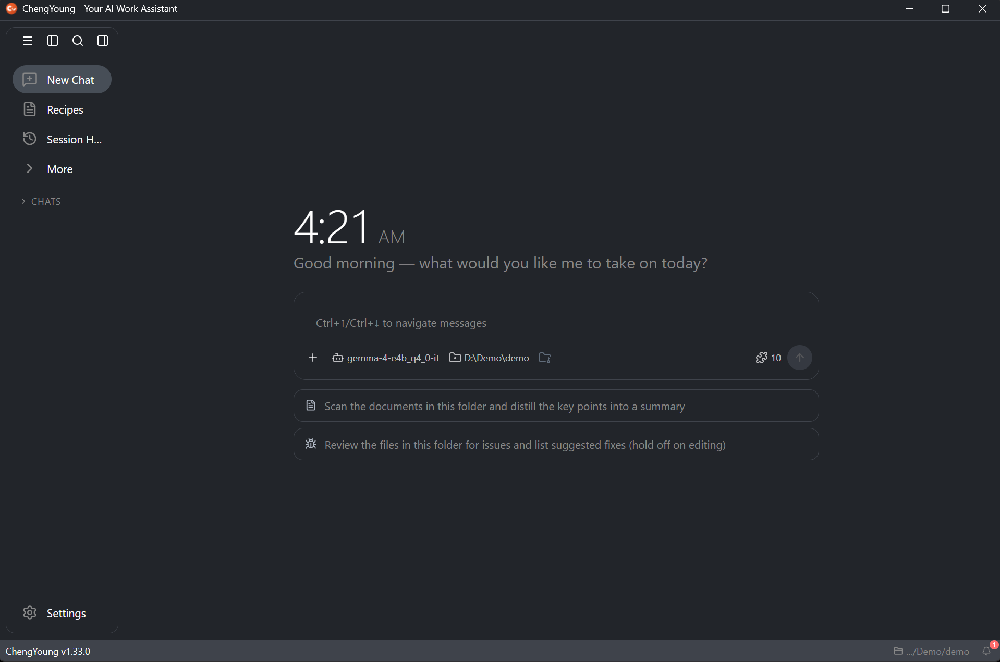

<div align="center">

# ChengYoung

**Local-first desktop AI agent — ready out of the box, and your data never leaves your machine**

<a href="https://www.apache.org/licenses/LICENSE-2.0"></a>
<a href="https://github.com/getchengyoung/chengyoung/releases/latest"></a>


**English** | [简体中文](README.zh.md)

</div>

> **This repository hosts release artifacts only** (Windows installer, checksums, update manifest), **no source code**. Source code is not publicly released; what is published here is a ready-to-install, auto-updatable build.

ChengYoung is a general-purpose **desktop** AI agent that runs on your own computer, capable of handling coding, information retrieval, document organization, and everyday automation. Local inference (llama.cpp / GGUF) is built in, so it works fully offline; you can also connect your configured cloud model providers. No account is required, and no usage data is collected.

---

<div align="center">
  
</div>

## Highlights

| Area | What you get |
| --- | --- |
| **Lightweight custom Tauri 2 shell** | A custom Tauri 2 shell replaces the upstream Electron desktop runtime: **installer and shell are dramatically smaller than an Electron-based distribution**, reusing the OS WebView2; in-app **auto-update** (minisign-verified; rejected on signature mismatch) |
| **Fully local, zero telemetry** | Local inference with **Vulkan GPU acceleration** (stability-optimized for hybrid iGPU/dGPU setups); **no usage data is collected or uploaded** |
| **Secure embedded browser** | Third-party pages open in an **isolated panel** (a child webview in the main window): separate profile / zero injection / no access to app capabilities; Agent browser control is **off by default**, per-site authorization + per-action confirmation, sensitive field input is automatically intercepted on the page, and input content is never logged |

## Download and install (Windows 10 / 11, x64)

1. Open the [latest release](https://github.com/getchengyoung/chengyoung/releases/latest) and download `ChengYoung_<version>_x64-setup.exe`
2. Run the installer (per-user install, no administrator rights needed)
3. On first launch, download a local model under *Settings → Models*, or configure a cloud provider before you start

- Checksums: `SHA256SUMS.txt` in the same release
- In-app updates: *Settings → About ChengYoung → Check for updates* (the app periodically checks and downloads by default; **installation asks for confirmation**; installers are minisign-verified and rejected on signature mismatch)
- ⚠️ Fully quit the app (including the tray icon) before running an installer manually — a running app keeps the files locked, and you may see a “cannot write” error or be asked to restart.

## Key features

| Area | What you get |
| --- | --- |
| Local models | Search and download GGUF models from Hugging Face in-app, with GPU (Vulkan) acceleration; **models are not bundled**, and their licenses are governed by each model page (e.g. Qwen2.5 is Apache-2.0, the Gemma family follows the Google Gemma Terms) — please check before downloading whether a model fits your use case |
| Cloud models | Bring your own API key for Anthropic, OpenAI, Google, OpenRouter, Ollama and more |
| Sessions | History, rename, pin, export, archive, one-click **copy as Markdown** for sharing, and branch a new session from any message; very long sessions load the latest 100 messages first (older history expands on demand, Ctrl+F searches everything), and messages send instantly — the session is created in the background with your draft kept on failure |
| **Screenshot Ask** | Press Ctrl+Alt+A anywhere, select any region on a full-screen snapshot, and the screenshot goes straight into the input box — with three one-tap prompts (extract text / translate / solve). Screenshots are processed in memory only: never saved to disk, never uploaded. The shortcut is remappable or can be disabled in Settings |
| **Voice dictation** | Speak and have text filled into the input box: on-device Whisper transcription (**fully offline**) or cloud providers (OpenAI / Groq / ElevenLabs); the transcription language is configurable in Settings |
| **Session modes** | Autonomous / Manual / Smart / Chat-only — switch in one click from the input box (applies to the current session; the default for new sessions lives in Settings) |
| Workflows (Recipes) | Turn recurring tasks into reusable flows and share them with `goose://recipe?...` links; the content is shown and changes are confirmed before running |
| Skills / Apps / Scheduler / Extensions | Built-in capabilities are managed visually in-app; extensions use the MCP protocol (third-party MCP servers supported), and sensitive actions require permission first |
| **Agent browser control** | Read page text, click elements, and type into or submit forms — **off by default**, per-site authorization + per-action confirmation, sensitive field input is automatically intercepted on the page, and input content is never logged |
| Workspace right panel | Files, media and run results — plus an **embedded browser** (third-party pages open in an **isolated panel** with their own profile and cannot reach the app or your files) |
| Prompts and hints | Inspect or override the 9 built-in prompt templates, and edit the project hint file (`.cyhints`, with `.goosehints` supported; global hints are read-only and visible in the hint file chain) |
| **Notification center** | A bell in the status bar archives every notification: unread counter, per-item dismiss and clear all; the archive lives in memory only and is never written to any file |
| Context & workspace awareness | Persistent context-usage and auto-compaction bar in the top bar; a badge for uncommitted workspace changes (read-only, computed locally) |
| System integration | Tray icon, **minimize to tray on close**, global-shortcut quick launcher, **command palette**, `goose://` deep links, 16 UI languages |
| Permissions and security | Explicit permission prompts before tool calls, bound working directories, and secondary confirmation for workflow changes |

## Privacy and network access

- **No usage data is collected or uploaded**: the app does not include telemetry, device fingerprinting, or crash reporting.
- The app goes online in the following cases:
  1. Download local models (Hugging Face; user-initiated)
  2. Check for or download updates (GitHub Releases; the app **periodically checks and downloads by default**, which can be turned off in Settings → About ChengYoung)
  3. Call the APIs of the model or speech-to-text providers you configured (user-initiated)
- **About automatic checks**: the check request only fetches the version manifest from GitHub Releases and never uploads anything from your machine; once downloaded you are notified and **installation asks for confirmation**.
- Sessions and settings live on your machine in `%APPDATA%\ChengYoung\` (from 1.13.0, the first launch copies data from the legacy `%APPDATA%\Block\goose\` directory to the new one; the old directory is left untouched, so coexisting with the original Goose is safe. You can also override the data root with the `GOOSE_PATH_ROOT` environment variable).
- **Verify it yourself**: when none of the above is happening, watch the app's network activity with Windows Resource Monitor or Process Monitor — no outbound connections should appear.

## Requirements

- Windows 10 / 11 (x64)
- The installer is about 49 MB (slightly varies per release; the local inference engine is included); models are downloaded on demand, with separate download sizes
- Windows 11 ships with WebView2; on Windows 10 the installer fetches the WebView2 runtime if it is missing
- Memory reference for local models: **minimum to start** 8 GB (small models, short context); **comfortable** 16 GB RAM / 8 GB VRAM (7B models, 4K–8K context); **long context** 16 GB+ VRAM or 32 GB RAM (7B models, 16K+ context, or larger models). GPU acceleration requires a Vulkan-capable driver.

## Verify the download

```powershell
# Replace <version> with the version in the file name you downloaded (for example, ChengYoung_1.33.0_x64-setup.exe)
certutil -hashfile ChengYoung_<version>_x64-setup.exe SHA256
```

Compare the resulting hash with `SHA256SUMS.txt` from the same release. In-app update installers are automatically verified by the updater against the minisign signature (public-key fingerprint `3651-C9C4-6E36` — the first 12 hex characters of the built-in public key's SHA-256; see the Release page) and are rejected if it does not match.

## FAQ

- **Does the automatic update check upload my data?** No. The check only fetches the version manifest from GitHub Releases and never uploads anything from your machine; both the check and the download can be turned off in Settings.
- **Will it conflict with the original Goose if both are installed?** No. ChengYoung 1.13.0+ uses its own data directory (`%APPDATA%\ChengYoung\`); the first launch copies legacy data over and the original Goose's directory is left untouched.
- **Will my old sessions survive the upgrade?** Yes. Legacy data is copied in full to the new directory — session history and configuration are preserved as-is.

## Feedback

- Issues and suggestions in this repository: [getchengyoung/chengyoung/issues](https://github.com/getchengyoung/chengyoung/issues)
- Website: https://chengyoung.com
- Email support: **support@chengyoung.com**
- In the app, *Settings → About ChengYoung* lets you copy a diagnostic report with one click (paste it into your issue or email to help diagnose the problem faster).

## Licensing and provenance

- This is a **branded build and independent distribution** of the open-source **Goose** project (Agentic AI Foundation / Linux Foundation, Apache License 2.0). It is **not** an official Goose release and is **not affiliated with, endorsed by, or sponsored by** the Goose project or its maintainers.
- **Notice of modifications** (Apache-2.0 §4): this distribution modifies upstream Goose as follows: (1) the Electron desktop runtime is replaced by a Tauri 2 shell; (2) an isolated browser panel and Agent browser control are added; (3) default configuration and security policies are adjusted (update signature verification, branded data directory, etc.). Unmodified parts stay identical to upstream.
- Distributed under the Apache License 2.0; **LICENSE**, **NOTICE**, and **THIRD_PARTY_NOTICES** (the exhaustive third-party license list) ship with the installer (installed under the application's `resources/` directory) and include upstream attribution and third-party notices.
- Only prebuilt binaries are published here; **no source code is provided**. Names such as "Goose" appear for attribution only and remain the property of their respective owners.
- Local models are fetched from Hugging Face by the app and are **not redistributed** here; each model's license is governed by its model page (for example Qwen2.5 is Apache-2.0, while the Gemma family follows the Google Gemma Terms).
